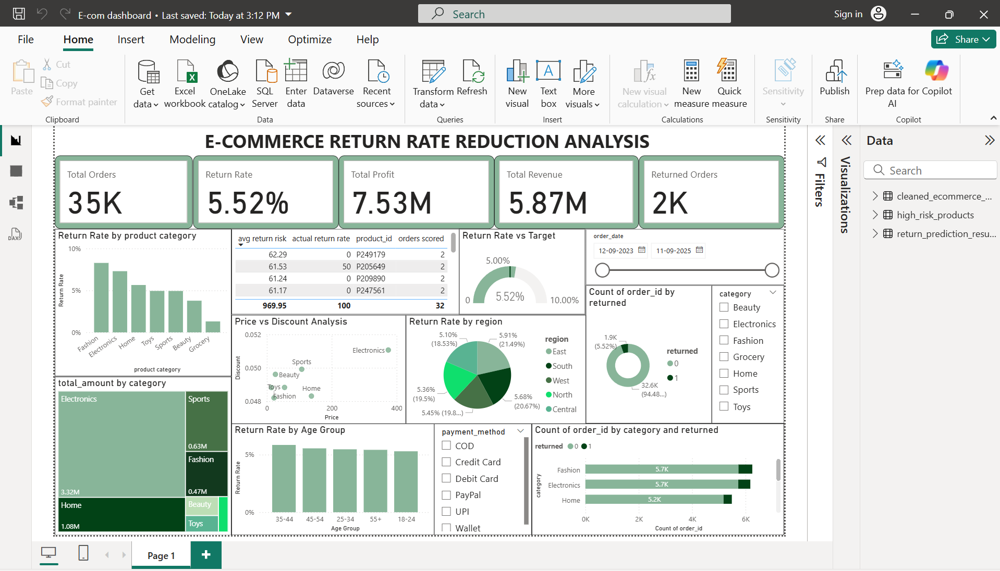

# E-Commerce Return Rate Reduction Analysis

### End-to-End Data Analytics & Machine Learning Project

## 1. Project Overview

This project focuses on analysing e-commerce product returns and identifying factors associated with customer returns. It uses Python, SQL, Machine Learning, and Power BI to transform raw transaction data into meaningful business insights.

The project also develops a machine learning model to estimate return probabilities and identify potentially high-risk orders.

## 2. Project Objectives

- Analyse e-commerce transaction and return data.
- Identify product categories and regions with higher return rates.
- Understand customer purchasing and return patterns.
- Perform data cleaning and exploratory data analysis.
- Build a machine learning model to predict potential returns.
- Develop an interactive Power BI dashboard.
- Provide data-driven recommendations to reduce product returns.

## 3. Tools & Technologies

| Tool | Purpose |
|---|---|
| Python | Data cleaning and analysis |
| Pandas & NumPy | Data preprocessing |
| Matplotlib & Seaborn | Data visualization |
| Scikit-learn | Machine learning |
| SQL | Business data analysis |
| Power BI | Interactive dashboard |
| Excel | Data inspection and reporting |
| Jupyter Notebook / Google Colab | Development environment |

The dataset has an imbalanced target variable, with returns representing approximately 5.52% of transactions. Therefore, accuracy alone is not sufficient to evaluate model performance.

The model is an exploratory baseline and requires further improvement before any real-world deployment.

## 4. Power BI Dashboard

The interactive dashboard presents:

- Total Orders
- Returned Orders
- Return Rate
- Total Revenue
- Total Profit
- Return Rate by Category
- Return Rate by Region
- Monthly Return Trends
- Payment Method Analysis
- High-Risk Product Analysis

Interactive slicers allow users to explore business performance across different categories, regions, dates, and payment methods.

## 5. Key Business Insights

- Fashion recorded the highest category return rate at approximately 8.28%.
- Electronics recorded a return rate of approximately 7.30%.
- Grocery had the lowest category return rate at approximately 1.31%.
- The overall return rate was approximately 5.52%.
- Returned transactions had a higher average product price than non-returned transactions.

These findings represent observed associations and do not establish causal relationships.

## 6. Business Recommendations

- Investigate product categories with higher return rates.
- Improve product descriptions and product information.
- Monitor high-risk products and return patterns.
- Analyse customer feedback and reasons for returns.
- Regularly monitor return trends through business dashboards.
- Improve the prediction model using additional relevant data.

## 7. Future Scope

- Improve model performance through additional feature engineering.
- Explore advanced classification algorithms.
- Incorporate customer feedback and return reasons.
- Develop a real-time return-risk monitoring system.
- Integrate predictive insights into business decision-making.

## 8. Power BI Dashboard Preview

## 9. Conclusion

This project demonstrates how data analytics, SQL, machine learning, and business intelligence tools can be combined to analyse e-commerce returns and support informed business decisions.

It provides practical exposure to an end-to-end analytics workflow, from raw data preprocessing to predictive analysis and interactive dashboard development.
